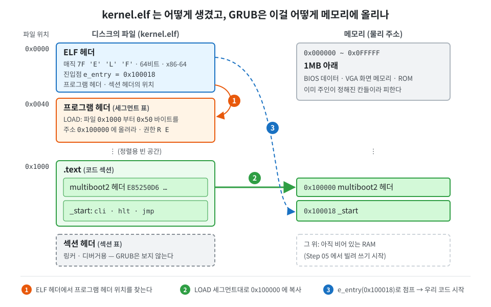

# Step 01-1 — 빌드 체계와 multiboot2 헤더

운영체제를 만든다고 하면 보통 "커널 코드"부터 떠올리지만, 맨 처음 부딪히는 벽은 코드가 아니라 **어떻게 내 코드를 CPU 위에 올려놓을 것인가** 입니다.
컴퓨터가 켜지면 BIOS가 가장 먼저 돌고, BIOS는 디스크(여기서는 CD 이미지)에서 부트로더를 찾아 실행합니다. 이 프로젝트는 부트로더를 직접 만들지 않고 GRUB을 빌려 씁니다.
GRUB은 여러 운영체제를 부팅할 수 있는 범용 부트로더라서, 우리 커널이 "나는 GRUB으로 부팅할 수 있는 커널이다"라고 정해진 형식으로 신호만 보내면 커널 파일을 메모리에 올리고 첫 명령으로 점프해 줍니다.
그 신호가 **multiboot2 헤더** 입니다.

이번 단계의 목표는 아주 소박합니다. 화면에 아무것도 나오지 않습니다. 대신 GRUB 메뉴에서 `micro-os` 를 골랐을 때 "no multiboot header found" 같은 오류 없이 화면이 조용히 멈춰 있으면 성공입니다.
이 조용함이 뜻하는 바는 "빌드 체계가 올바른 ELF를 만들었고, 그 ELF가 올바른 주소에 놓였고, GRUB이 헤더를 알아보고 우리 `_start` 로 점프했다"는 것입니다.
첫 단계에서 이걸 따로 확인하는 이유는, 다음 단계부터 문제가 생겼을 때 적어도 "부팅 경로 자체는 맞다"는 사실을 깔고 시작할 수 있기 때문입니다.

## 전원을 켜면 일어나는 일: 부트로더

전원 버튼을 누른 직후의 CPU는 아무것도 모릅니다. 메모리는 비어 있고, 디스크에 무엇이 있는지도, 파일시스템이 무엇인지도 모릅니다. CPU가 아는 것은 단 하나, "리셋되면 정해진 주소(`0xFFFFFFF0`, 리셋 벡터)의 명령부터 실행한다"는 규칙뿐입니다.
그 주소에는 메인보드의 ROM에 들어 있는 **펌웨어**, 즉 BIOS(또는 요즘 PC라면 UEFI)가 연결되어 있습니다.

**ROM과 펌웨어.** RAM은 전원이 꺼지면 내용이 사라지기 때문에, 전원을 켠 순간에는 실행할 코드가 하나도 없습니다. 그래서 메인보드에는 전원이 없어도 내용이 남는 칩이 따로 붙어 있습니다. 원래는 공장에서 한 번 쓰면 바꿀 수 없는 ROM(Read-Only Memory)이었고, 요즘은 다시 쓸 수 있는 플래시 메모리지만 관습적으로 여전히 ROM이라고 부릅니다.
이 칩에 들어 있는 프로그램이 **펌웨어** 입니다. 하드웨어(firm)에 붙박이로 들어 있는 소프트웨어라는 뜻으로, 디스크에 설치하는 운영체제와 달리 메인보드를 살 때부터 들어 있습니다. 펌웨어가 하는 일은 하드웨어를 깨워서 점검하고, 운영체제를 불러올 수 있는 상태까지 데려다 놓는 것입니다.
중요한 점은 이 ROM 칩도 RAM처럼 **주소로 보인다** 는 것입니다. 메인보드가 특정 주소 범위에 대한 읽기 요청을 RAM 대신 ROM 칩으로 보내도록 배선되어 있어서, CPU는 펌웨어 코드를 디스크에서 읽어 올 필요 없이 그 주소에서 바로 실행할 수 있습니다. 리셋 벡터 `0xFFFFFFF0` 이 바로 그런 주소이고, 같은 BIOS 코드가 1MB 바로 아래(`0xF0000`~`0xFFFFF`)에도 비쳐 보이도록 연결되어 있습니다.

**리얼 모드와 1MB.** 이때 CPU는 1978년의 8086과 호환되는 16비트 **리얼 모드** 로 시작합니다. 64비트 CPU도 예외 없이 이 상태에서 출발합니다.
리얼 모드에서 주소는 "세그먼트 × 16 + 오프셋"으로 만들어집니다. 둘 다 16비트라서 만들 수 있는 가장 큰 주소는 대략 `0xFFFFF`, 즉 1MB입니다. 8086에는 주소선이 20개뿐이었기 때문에 정해진 방식이고, 지금 CPU도 호환성을 위해 리얼 모드에서는 이 계산을 그대로 따릅니다.
여기서 헷갈리기 쉬운 점이 있습니다. "1MB까지만 주소를 쓸 수 있다"는 것은 **RAM이 1MB뿐이라는 뜻이 아닙니다.** 컴퓨터에 512MB든 16GB든 RAM은 그대로 꽂혀 있습니다. 다만 리얼 모드의 주소 계산으로는 그중 첫 1MB까지만 가리킬 수 있어서, 나머지는 존재하지만 손이 닿지 않는 상태입니다. 보호 모드로 넘어가면 32비트 주소(4GB)를, 롱 모드로 넘어가면 그보다 훨씬 넓은 주소를 쓸 수 있게 되고, 그때 비로소 나머지 RAM을 쓸 수 있습니다. 1MB 위에 커널을 올리려면 부트로더가 모드를 바꿔야 하는 이유가 이것입니다.
또 그 1MB가 전부 RAM인 것도 아닙니다. 주소는 "어딘가로 가는 번지"일 뿐이고, 번지마다 연결된 장치가 다릅니다. 첫 1MB는 대략 이렇게 나뉘어 있습니다.

```
0x00000 ~ 0x9FFFF   RAM (640KB, BIOS 데이터 · 부트로더가 쓰는 곳, 0x7C00도 여기)
0xA0000 ~ 0xBFFFF   그래픽 카드의 화면 메모리 (VGA 텍스트 버퍼 0xB8000 이 여기)
0xC0000 ~ 0xFFFFF   ROM (그래픽 카드 · 장치 펌웨어, 맨 위 64KB가 BIOS)
```

같은 "메모리 주소"라도 `0xB8000` 에 쓰면 화면에 글자가 나오고, `0xF0000` 을 읽으면 BIOS 코드가 나옵니다. 이렇게 하나의 주소 공간 안에 RAM, 장치 메모리, ROM이 섞여 있는 구조는 1MB 위에서도 마찬가지라서, Step 05에서 GRUB이 알려 주는 메모리 맵을 읽어 "어디가 진짜 RAM인가"를 따로 확인하게 됩니다. 커널을 1MB(`0x100000`)부터 놓는 이유도, 1MB 아래는 이렇게 이미 주인이 정해진 칸들로 붐비기 때문입니다.

**BIOS란 무엇인가.** BIOS(Basic Input/Output System)는 1981년 IBM PC와 함께 등장한 펌웨어로, 이름 그대로 "기본적인 입출력"을 맡습니다. 하는 일은 크게 셋입니다.
첫째, 전원을 켜면 **POST(Power-On Self-Test)** 를 합니다. CPU와 메모리가 정상인지 확인하고, 메모리 크기를 세고, 그래픽 카드 같은 장치를 초기화합니다. 부팅할 때 잠깐 보이는 제조사 로고와 메모리 검사 화면이 이 단계입니다.
둘째, 부팅할 장치를 골라 그 장치의 첫 코드를 실행합니다. 이것이 아래에서 볼 부트로더 찾기입니다.
셋째, 운영체제나 부트로더가 쓸 수 있는 **서비스** 를 제공합니다. 리얼 모드 코드가 `int` 명령으로 정해진 번호를 부르면 BIOS가 일을 대신해 줍니다. `int 0x10` 은 화면에 글자 찍기, `int 0x13` 은 디스크 섹터 읽기, `int 0x15` 의 `e820` 기능은 "RAM이 어디에 얼마나 있는가"를 알려 주는 메모리 맵입니다. 아직 디스크 드라이버도 화면 드라이버도 없는 부트로더는 이 서비스들에 기대어 일을 합니다. GRUB이 multiboot2 정보 구조체에 담아 우리에게 넘겨주는 메모리 맵도, GRUB이 이 `e820` 서비스로 BIOS에게 물어서 얻은 것입니다. 다만 이 서비스들은 리얼 모드 전용이라, 64비트로 넘어간 우리 커널은 쓸 수 없습니다. 그래서 이후 단계에서 화면, 키보드, 디스크 드라이버를 전부 직접 만들게 됩니다.
2010년대부터 나온 PC는 BIOS 대신 **UEFI** 라는 새 펌웨어를 씁니다. UEFI는 디스크의 파일시스템(FAT)을 직접 읽어 부트로더 *파일* 을 실행하는 등 훨씬 똑똑하지만, 대부분 BIOS 방식도 흉내 낼 수 있습니다(CSM, Legacy 부팅). 이 프로젝트는 QEMU의 기본 펌웨어인 SeaBIOS, 즉 전통적인 BIOS 위에서 부팅합니다.

**BIOS가 부트로더를 찾는 방법.** BIOS 설정 화면에서 정하는 "부팅 순서(Boot Order)"가 있습니다. BIOS는 그 순서대로 장치를 하나씩 확인합니다. 이때 BIOS는 파일시스템을 전혀 모릅니다. 그래서 "파일 이름"이 아니라 **정해진 위치의 바이트** 만 봅니다.
하드 디스크나 USB라면 맨 앞 섹터, 즉 LBA 0번 섹터 512바이트를 읽습니다. 이 섹터를 MBR(Master Boot Record)이라고 부르고, 이 섹터의 마지막 두 바이트(오프셋 510, 511)가 `0x55 0xAA` 인지 확인합니다. 이 두 바이트가 "이 디스크에는 부팅 코드가 들어 있다"는 서명입니다. 서명이 있으면 512바이트 전체를 메모리 `0x7C00` 에 복사하고, `dl` 레지스터에 "어느 디스크에서 읽었는지" 번호를 담아 `0x7C00` 으로 점프합니다. 서명이 없으면 그 장치는 건너뛰고 다음 장치를 확인합니다.

```
LBA 0 (512바이트)
┌───────────────────────────────┬──────────────────┬─────────┐
│ 부트 코드 (446바이트)          │ 파티션 표 (64B)   │ 55 AA   │
└───────────────────────────────┴──────────────────┴─────────┘
  → BIOS가 0x7C00 에 통째로 올리고 점프                  ↑ 이게 없으면 다음 장치로
```

CD는 섹터 크기도 형식도 달라서 **El Torito** 라는 별도 규격을 따릅니다. CD의 파일시스템(ISO 9660) 앞부분 정해진 위치(17번 섹터)에 "부트 레코드"가 있고, 그 레코드가 "부트 카탈로그"의 위치를, 카탈로그가 다시 "부팅용 이미지"의 위치를 가리킵니다. BIOS는 이 사슬을 따라가 이미지를 메모리에 올리고 실행합니다. `grub-mkrescue` 가 ISO를 만들 때 이 구조를 채우고 GRUB의 첫 단계 코드를 부팅용 이미지로 넣어 줍니다.
우리 QEMU 실행으로 예를 들면, Step 16부터는 CD(`micro.iso`)와 함께 하드 디스크(`disk.img`)도 꽂습니다. `disk.img` 는 ext2 파일시스템만 들어 있고 맨 앞 섹터에 `55 AA` 서명이 없으므로, BIOS가 그 디스크를 먼저 확인하더라도 부팅할 수 없는 디스크로 보고 넘어가 CD에서 GRUB을 찾게 됩니다.

BIOS의 일은 여기까지입니다. 512바이트(또는 CD의 부트 이미지)를 올려 실행해 줄 뿐, 파일을 찾아 주지도, 64비트로 바꿔 주지도 않습니다. 그 뒤의 일을 맡는 프로그램이 **부트로더** 입니다.

부트로더가 해야 할 일은 생각보다 많습니다. 디스크에서 커널 파일을 찾아야 하는데, 그러려면 파일시스템(ext2, FAT, ISO9660 …)을 해석할 줄 알아야 합니다. 커널 파일의 형식(ELF)을 읽어 각 부분을 정해진 주소에 올려야 하고, 1MB 위에 올리려면 리얼 모드를 벗어나 보호 모드로 넘어가야 합니다. 커널이 나중에 필요로 할 정보, 특히 "RAM이 어디에 얼마나 있는가"를 펌웨어에게 물어 정리해 두어야 하고, 마지막으로 커널의 첫 명령으로 점프해야 합니다.
이 모든 것을 512바이트 안에 넣을 수는 없습니다. 그래서 실제 부트로더는 여러 단계로 나뉩니다. MBR의 작은 코드가 디스크의 다른 곳에 있는 더 큰 코드를 불러오고, 그 코드가 파일시스템 드라이버와 메뉴를 갖춘 본체를 불러오는 식입니다.

**GRUB** 은 이런 일을 모두 해 주는 범용 부트로더로, 대부분의 Linux 배포판이 쓰는 바로 그 프로그램입니다. 직접 부트로더를 만드는 것도 좋은 공부지만 그것만으로도 큰 프로젝트라서, 이 커널은 GRUB을 빌려 쓰고 곧바로 커널 쪽 이야기로 들어갑니다.
GRUB이 아무 파일이나 커널로 부팅해 주는 것은 아닙니다. 부트로더와 커널 사이에 "커널은 이런 표시를 달고, 부트로더는 이런 상태로 넘겨준다"는 약속이 필요한데, 그 약속이 **multiboot** 규격이고, 우리가 쓰는 것은 그 두 번째 판인 multiboot2입니다. 커널이 지켜야 할 쪽의 약속이 아래에서 볼 multiboot2 헤더이고, GRUB이 지키는 쪽의 약속은 "CPU를 32비트 보호 모드로 바꾸고, 페이징은 끈 채로, `eax` 에 매직 값을, `ebx` 에 정보 구조체의 주소를 담아 커널 진입점으로 점프한다"는 것입니다. 이 정보 구조체 안에 GRUB이 BIOS에게 물어 정리한 메모리 맵이 들어 있고, Step 05에서 이걸 읽게 됩니다.

이 프로젝트에서는 `grub-mkrescue` 가 GRUB과 우리 커널을 함께 담은 부팅 가능한 CD 이미지(`micro.iso`)를 만들고, QEMU는 그 이미지를 CD로 꽂은 가상 PC를 띄웁니다. QEMU의 기본 펌웨어는 SeaBIOS라는 BIOS 구현이라 위에서 설명한 전통적인 BIOS 부팅 흐름을 그대로 따릅니다. 정리하면 이 커널의 부팅 경로는 이렇습니다.

```
전원 ON → CPU 리셋 (16비트 리얼 모드)
       → BIOS(SeaBIOS): 장치 점검, CD의 부트 이미지 로드
       → GRUB: 메뉴 표시, /boot/kernel.elf 를 찾아 1MB에 로드, 메모리 맵 수집
       → 32비트 보호 모드로 전환 후 우리 _start 로 점프   ← 여기서부터 우리 코드
```

## 이번 단계에서 만드는 것

파일은 네 개입니다. `Makefile` 이 소스를 커널 ELF로 만들고 ISO로 굽습니다. `linker.ld` 는 그 ELF 안에서 코드와 데이터를 어느 주소에 둘지 정합니다. `grub.cfg` 는 GRUB 메뉴에 무엇을 띄울지 적습니다. 그리고 `boot/boot.s` 에는 multiboot2 헤더와, 받자마자 멈추는 `_start` 만 있습니다.
읽는 순서는 `Makefile` → `linker.ld` → `grub.cfg` → `boot/boot.s` 를 권합니다. "무엇이 만들어지는가"를 먼저 알고 나서 "그 안에 무엇이 있는가"를 보는 편이 덜 헷갈립니다.

## 크로스 컴파일과 커널용 컴파일 옵션

우리가 평소 쓰는 gcc는 "리눅스 위에서 돌아갈 프로그램"을 만든다고 가정합니다. 그래서 몰래 C 표준 라이브러리를 링크하고, 시작 코드(`crt0`)를 붙이고, 운영체제가 제공하는 기능을 믿고 코드를 만듭니다.
커널에는 그런 것이 하나도 없습니다. 우리가 바로 그 운영체제이기 때문입니다. 원래 Makefile이 `x86_64-elf-gcc` 라는 **크로스 컴파일러** 를 쓰는 이유가 이것으로, 이 컴파일러는 특정 운영체제를 가정하지 않는 순수한 x86-64 ELF를 만듭니다.
Linux 호스트의 gcc로도 충분히 빌드할 수 있는데, 그러려면 `CFLAGS` 의 옵션들이 그 가정을 하나씩 꺼 줘야 합니다.

`-ffreestanding` 은 "표준 라이브러리가 없는 환경"이라고 컴파일러에게 알립니다. `-fno-builtin` 은 `memcpy` 같은 이름을 컴파일러가 마음대로 내장 함수로 바꾸지 못하게 합니다. `-fno-stack-protector` 는 스택 보호 코드가 런타임 함수를 부르지 않게 하고, `-fno-pic` 는 위치 독립 코드 대신 고정 주소 코드를 만들게 합니다.
특히 눈여겨볼 것은 `-mno-red-zone` 과 `-mno-sse` 계열입니다. x86-64 System V 규약에는 함수가 rsp 아래 128바이트를 허락 없이 써도 된다는 "레드 존"이 있습니다. 그런데 커널에서는 인터럽트가 아무 때나 현재 스택 위에 레지스터를 쌓기 때문에, 레드 존에 있던 값이 덮여 버립니다. 그래서 커널은 레드 존을 꺼야 합니다.
SSE를 끄는 이유는 아직 커널이 FPU/SSE 레지스터 상태를 저장하고 복원하는 코드를 갖고 있지 않아서입니다. 컴파일러가 최적화 삼아 SSE 레지스터를 쓰기 시작하면, 나중에 프로세스를 전환할 때 그 값이 섞여 버립니다.
링커 옵션 `-T linker.ld` 는 기본 링커 스크립트 대신 우리 스크립트를 쓰라는 뜻이고, `--nostdlib` 는 아무 라이브러리도 붙이지 말라는 뜻입니다.

Makefile의 나머지는 평범한 흐름입니다. `kernel`, `drivers`, `lib` 같은 폴더에서 `.c` 와 `.s` 를 찾아 `build/` 아래에 오브젝트를 만들고, 전부 링크해 `iso/boot/kernel.elf` 를 만든 뒤 `grub-mkrescue` 로 `iso/` 폴더를 통째로 부팅 가능한 `micro.iso` 로 굽습니다.
지금은 `boot/boot.s` 하나뿐이라 오브젝트도 하나지만, 폴더 목록은 처음부터 뒤 단계에서 생길 폴더(`mm`, `proc`, `shell`, `fs`)까지 적혀 있습니다. 없는 폴더는 `find` 가 조용히 넘어가므로, 앞으로 새 파일을 만들 때 Makefile을 고칠 일이 거의 없습니다. 이것이 이 단계가 깔아 두는 첫 번째 틀입니다.

## 커널 파일의 형식: ELF

빌드 결과물 `kernel.elf` 의 확장자 ELF는 **Executable and Linkable Format** 의 줄임말로, Linux를 비롯한 유닉스 계열에서 쓰는 실행 파일 형식입니다. 평소에 `gcc` 로 만든 프로그램도, `/usr/bin/ls` 도 전부 ELF 파일입니다. Windows의 `.exe`(PE 형식)에 해당한다고 보면 됩니다.

실행 파일은 기계어를 그냥 이어 붙인 덩어리가 아닙니다. 기계어 말고도 "이 코드를 메모리 어디에 올려야 하는가", "실행은 어디서부터 시작하는가", "어느 부분은 읽기 전용이고 어느 부분은 쓰기 가능한가" 같은 정보가 함께 있어야 합니다. ELF는 그 정보를 담는 규칙입니다. 구조는 크게 셋으로 나뉩니다.

```
[ELF 헤더]       매직 7F 'E' 'L' 'F', 32/64비트, CPU 종류, 진입점 주소(e_entry), 아래 표들의 위치
[프로그램 헤더]  세그먼트 목록 — "파일의 이 범위를 메모리의 이 주소에 이 크기로 올려라, 권한은 이것"
[섹션 데이터]    .text(코드) .rodata(상수) .data(전역 변수) .bss(0으로 시작하는 전역 변수) ...
[섹션 헤더]      섹션 목록 — 링커와 디버거가 쓰는 정보
```

여기서 꼭 구분할 것은 **섹션** 과 **세그먼트** 입니다. 섹션은 링커가 다루는 단위로, 컴파일러가 만든 `.text`, `.data` 같은 조각들입니다. 세그먼트는 프로그램을 **실행하는 쪽** 이 보는 단위로, 같은 권한을 가진 섹션들을 묶어 "메모리 어디에 올릴지"를 적은 것입니다. 그래서 프로그램을 메모리에 올리는 쪽, 즉 로더는 섹션 헤더를 볼 필요가 없고 프로그램 헤더만 보면 됩니다.
GRUB이 바로 그 로더 역할을 합니다. `kernel.elf` 의 프로그램 헤더를 읽어 각 세그먼트를 적힌 주소(1MB 근처)에 복사하고, `.bss` 처럼 파일에는 없고 메모리에만 필요한 부분은 0으로 채운 뒤, ELF 헤더의 진입점 `e_entry`(우리의 `_start`)로 점프합니다.
그 주소들을 정하는 것이 바로 다음 절의 링커 스크립트입니다. 그리고 Step 18에서는 GRUB 대신 우리 커널이 직접 ELF 로더가 되어, 디스크에 있는 유저 프로그램의 프로그램 헤더를 읽고 메모리에 올리게 됩니다. 그때 이 구조를 다시 만나게 됩니다.

그림으로 보면 이렇습니다. 숫자는 이 단계의 커널을 실제로 빌드해 `readelf` 로 읽은 값입니다.



직접 확인해 보려면 빌드한 뒤 다음 명령을 써 보세요.

```sh
readelf -h iso/boot/kernel.elf    # ELF 헤더: Entry point address 가 _start 주소
readelf -l iso/boot/kernel.elf    # 프로그램 헤더: LOAD 세그먼트가 0x100000 근처에 놓이는지
readelf -S iso/boot/kernel.elf    # 섹션 헤더: .text 가 0x100000 에서 시작하는지
```

`readelf -S` 에 `.multiboot2` 섹션이 따로 보이지 않는 것은 정상입니다. 링커 스크립트가 그 섹션을 `.text` 맨 앞에 합쳐 넣기 때문입니다. `readelf -S` 가 알려 주는 `.text` 의 파일 Offset(보통 `0x1000`)을 `xxd -s 0x1000 -l 16 iso/boot/kernel.elf` 로 들여다보면 매직 넘버가 `d6 50 52 e8`(리틀 엔디언으로 저장된 `0xE85250D6`)로 들어 있는 것을 확인할 수 있습니다.

## 링커 스크립트: 커널은 1MB에서 시작한다

`linker.ld` 의 첫 줄 `. = 1M;` 은 "지금부터 배치하는 것은 주소 `0x100000` 부터"라는 뜻입니다. 1MB 아래는 BIOS 데이터, VGA 메모리, 각종 ROM이 뒤섞인 오래된 영역이라 피하는 것이 관례이고, GRUB도 이 관례를 따릅니다.
그 뒤로 `.text`(코드), `.rodata`(읽기 전용 데이터), `.data`(초기값 있는 전역 변수), `.bss`(0으로 시작하는 전역 변수)를 4KB 경계에 맞춰 차례로 놓습니다. 4KB 정렬은 지금 당장은 의미가 없지만, 나중에 페이지 단위로 권한을 다룰 때 섹션 경계와 페이지 경계가 맞아떨어지게 해 줍니다.

중요한 줄이 두 개 더 있습니다. 하나는 `.text` 안의 `*(.multiboot2)` 가 `*(.text*)` 보다 먼저 나온다는 점입니다. GRUB은 multiboot2 헤더를 **파일 앞부분 32KB 안에서, 8바이트 정렬된 위치에서만** 찾습니다. 헤더를 별도 섹션에 두고 맨 앞에 배치하는 이유가 이것입니다.
다른 하나는 맨 끝의 `_kernel_end = .;` 입니다. 커널 이미지가 메모리에서 어디까지 차지하는지 알려 주는 심볼인데, 지금은 아무도 쓰지 않습니다. Step 05에서 물리 메모리 관리자가 "여기까지는 커널이 쓰고 있으니 빌려 주면 안 된다"를 판단할 때 이 심볼을 읽습니다. 미래를 위해 미리 박아 두는 약속입니다.

## grub.cfg

`grub.cfg` 는 다섯 줄짜리 메뉴입니다. 기본 항목을 0번으로, 대기 시간을 3초로 두고, `micro-os` 항목에서 `multiboot2 /boot/kernel.elf` 로 커널을 불러온 뒤 `boot` 합니다.
여기서 `multiboot` 가 아니라 `multiboot2` 라고 쓰는 것이 중요합니다. 둘은 헤더 형식이 다른 별개의 규격이고, 우리 헤더는 multiboot2 형식이기 때문입니다.

## multiboot2 헤더 읽기

`boot.s` 의 헤더는 이렇게 생겼습니다.

```asm
.section .multiboot2
.align 8
mb2_start:
    .long MB2_MAGIC                 /* 0xE85250D6 */
    .long MB2_ARCH                  /* 0 = i386 (32비트 보호 모드로 진입) */
    .long mb2_end - mb2_start       /* 헤더 전체 길이 */
    .long -(MB2_MAGIC + MB2_ARCH + (mb2_end - mb2_start))   /* 체크섬 */
    .short 0                        /* 종료 태그: type 0 */
    .short 0                        /*            flags 0 */
    .long  8                        /*            size 8 */
mb2_end:
```

GRUB은 파일 앞부분을 훑다가 매직 넘버 `0xE85250D6` 을 발견하면, 바로 뒤의 아키텍처와 길이를 읽고, 네 값을 32비트로 더했을 때 0이 되는지 확인합니다. 체크섬 칸에 나머지 셋의 합의 음수를 넣어 두는 것이 그 조건을 맞추는 방법입니다.
그 뒤에는 "태그"들이 이어질 수 있습니다. 화면 해상도를 요청하거나, 특정 주소에 로드해 달라고 요청하는 태그들이 있는데, 우리는 아무것도 요청하지 않으므로 목록의 끝을 뜻하는 종료 태그(type 0, size 8) 하나만 둡니다.
아키텍처 0(i386)의 의미도 알아 두세요. GRUB은 우리 커널로 점프할 때 CPU를 **32비트 보호 모드, 페이징 꺼짐** 상태로 넘겨줍니다. 64비트 롱 모드로 가는 일은 전부 우리 몫이고, 그게 Step 01-3의 주제입니다.

## 멈추기만 하는 `_start`

헤더 아래의 진입점은 세 줄뿐입니다.

```asm
.code32
.global _start
_start:
    cli
.hang32:
    hlt
    jmp .hang32
```

`.code32` 는 이 아래를 32비트 명령으로 어셈블하라는 지시입니다. GRUB이 32비트 상태로 넘겨주니 당연합니다.
`cli` 는 인터럽트를 끕니다. 아직 인터럽트를 받을 준비(IDT)가 없으니, 혹시라도 인터럽트가 들어오면 CPU가 엉뚱한 곳으로 점프하다 리셋됩니다.
`hlt` 는 다음 인터럽트가 올 때까지 CPU를 재우는 명령입니다. 인터럽트를 꺼 두었으니 사실상 영원히 잡니다. 그래도 NMI처럼 끌 수 없는 인터럽트가 깨울 수 있어서, 깨어나면 다시 `hlt` 로 돌아가도록 `jmp` 를 붙여 둡니다.
`ENTRY(_start)` 가 링커 스크립트 첫 줄에 있으므로, ELF 헤더의 진입점이 이 `_start` 가 되고 GRUB은 여기로 점프합니다.

## 이 단계가 뒤에 남기는 것

눈에 보이는 결과는 없지만, 앞으로 바뀌지 않을 기초가 여기서 정해집니다.
커널은 물리 1MB에서 시작하고, 끝 주소는 `_kernel_end` 로 알 수 있습니다. 새 소스 파일은 정해진 폴더에 두기만 하면 Makefile이 알아서 빌드합니다. 커널은 표준 라이브러리, 레드 존, SSE 없이 컴파일됩니다. 그리고 GRUB은 우리를 32비트 보호 모드로 `_start` 에 내려놓습니다.
이후의 모든 단계는 이 네 가지를 당연한 전제로 삼습니다.

## 직접 만들어 보기

빈 폴더에서 시작한다면 `boot.s` 에 헤더와 `_start` 만 쓰고, 링커 스크립트와 Makefile을 붙여 빌드해 보세요.
QEMU를 띄우기 전에 `grub-file --is-x86-multiboot2 iso/boot/kernel.elf && echo OK` 로 GRUB의 판정을 미리 받아 볼 수 있습니다. 출력이 없다면 헤더에 문제가 있는 것입니다.
일부러 체크섬을 1만큼 틀리게 하거나, 링커 스크립트에서 `*(.multiboot2)` 줄을 지워서 같은 명령이 실패하는 것도 확인해 보면, GRUB이 무엇을 보고 판단하는지 손으로 익힐 수 있습니다.
`readelf -h iso/boot/kernel.elf` 로 진입점 주소가 `0x100000` 근처인지, `readelf -l` 로 세그먼트가 1MB에 배치됐는지도 보세요.

## 확인하기

```sh
make CC=gcc LD=ld AS=as MKRSC=grub-mkrescue
qemu-system-x86_64 -cdrom micro.iso -m 512M -serial stdio
```

GRUB 메뉴가 뜨고 3초 뒤 `micro-os` 가 선택되면, 화면이 검게 바뀐 채 아무 반응 없이 멈춰 있어야 합니다. 재부팅이 반복되거나 GRUB 오류 메시지가 나오면 실패입니다.
QEMU 창에서 `Ctrl+Alt+2` 를 눌러 모니터로 가서 `info registers` 를 입력하면 `EIP` 가 `_start` 근처(`0x10001x`)에 있는 것을 볼 수 있습니다. 우리 코드에 도착했다는 가장 확실한 증거입니다. `Ctrl+Alt+1` 로 화면에 돌아옵니다.

## 막혔을 때

GRUB이 "no multiboot header found" 를 낸다면 원인은 셋 중 하나입니다. 헤더가 파일 앞 32KB 밖에 있거나(링커 스크립트의 섹션 순서), 8바이트 정렬이 안 됐거나(`.align 8`), 체크섬이 틀렸습니다. `grub-file` 로 빠르게 좁혀 보세요.
헤더는 통과했는데 GRUB이 커널 로드 중 오류를 낸다면 종료 태그를 다시 보세요. type 0, flags 0, size 8 이 아니면 GRUB이 태그 목록의 끝을 찾지 못합니다.
링크 단계에서 `_start` 를 찾지 못한다는 경고가 나오면 `.global _start` 를 빠뜨린 것입니다.
Linux gcc로 빌드했는데 진입점이 이상한 주소라면, `LD=ld` 대신 `gcc` 로 링크해서 기본 스크립트가 끼어든 경우가 많습니다. 위의 `make` 명령처럼 `ld` 를 직접 쓰세요.

## 다음 단계로

지금은 커널이 살아 있는지 확인하려면 QEMU 모니터를 열어야 합니다. 화면에 글자 하나라도 찍을 수 있으면 훨씬 편하겠죠.
다음 단계에서는 드라이버도 C 코드도 없이, 화면 메모리에 바이트를 직접 써서 `OK` 를 띄웁니다. 그 김에 GRUB이 레지스터로 넘겨준 값도 잃어버리기 전에 저장해 둡니다 → [Step 01-2](step01-2-vga32.md)
